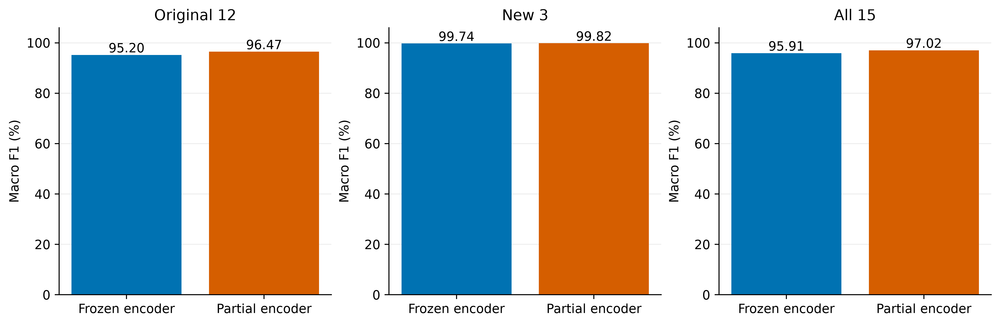
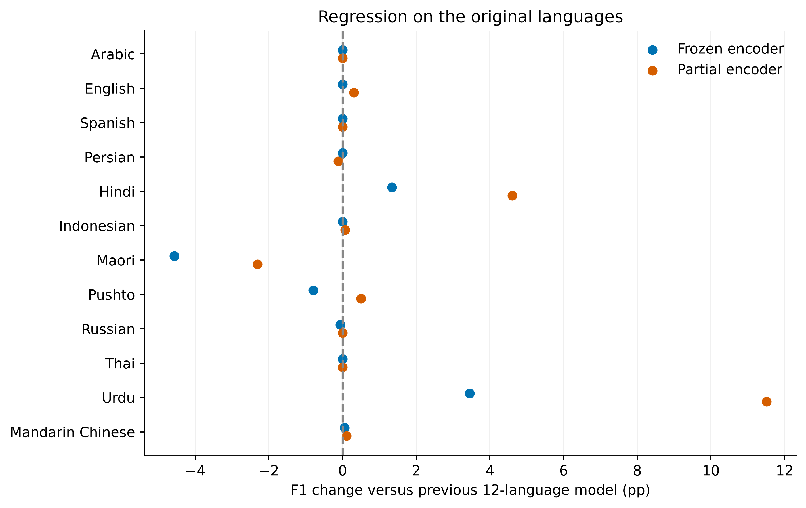
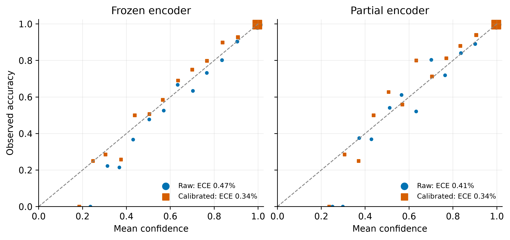

# Adding Samoan, Niuean and Tongan

## Experiment

- Vocabulary: the original 12 languages plus `sam`, `niu`, `ton`. **Cook Islands Māori is excluded.**
- Audited 44,822 new cuts; 0 excluded. Grouped by source recording, approximately 80% train / 5% checkpoint selection / 5% calibration / 10% test. Source grouping does not establish speaker independence.
- One paired run, seed 42. Both methods start from the same expanded classifier and replay original VoxLingua training data with equal class sampling.
- Frozen: train classifier only. Partial: additionally train ECAPA `mfa`, `asp`, and `fc`; earlier blocks and encoder batch-normalization parameters/statistics stay frozen.
- AdamW; head LR 1e-4, encoder LR 1e-5, effective batch 32, at most 20 epochs of 32,768 samples, patience 5. Select by 15-class validation macro F1, then balanced NLL.
- Mono 16 kHz, 10-second maximum center crop; native log-mel sentence mean normalization, no Samoan-specific amplification.
- FLEURS test evaluates the old 12; source-held-out local test cuts evaluate the new 3. Every extension evaluation retains **all 15 outputs**. Domains differ, so combined accuracy depends on dataset composition.
- Temperatures fit on separate FLEURS + new-language calibration data. ECE uses 15 equal-width bins. Old-only calibration comparisons are also in the CSV.

## Results

All metric values are percentages. Precision, recall and F1 are macro-averaged over the indicated group.

| Model | Group | Test n | Accuracy | Precision | Recall | F1 | ECE raw | ECE calibrated |
|---|---|---:|---:|---:|---:|---:|---:|---:|
| Frozen encoder | old12 | 8,519 | 96.74 | 95.81 | 94.82 | 95.20 | 1.02 | 0.50 |
| Frozen encoder | new3 | 4,545 | 99.71 | 99.77 | 99.72 | 99.74 | 0.71 | 1.39 |
| Frozen encoder | all15 | 13,064 | 97.77 | 96.22 | 95.80 | 95.91 | 0.47 | 0.34 |
| Partial encoder | old12 | 8,519 | 97.73 | 96.78 | 96.22 | 96.47 | 0.75 | 0.56 |
| Partial encoder | new3 | 4,545 | 99.78 | 99.85 | 99.78 | 99.82 | 0.46 | 0.86 |
| Partial encoder | all15 | 13,064 | 98.45 | 97.15 | 96.94 | 97.02 | 0.41 | 0.34 |

- Previous 12-language head: old-language accuracy **97.63%**, macro F1 **95.25%**. All original reference results were recomputed and checked against the saved experiment.
- Read original-language regressions alongside new-language gains; checkpoint selection did not impose a regression limit.

### Matched original-language comparison

Same 8,519 FLEURS test recordings; temperatures fitted using the original FLEURS validation set only. All values are percentages.

| Model | Accuracy | Macro F1 | Calibrated ECE |
|---|---:|---:|---:|
| Original 107 | 90.82 | 90.87 | 2.00 |
| Filtered 12 | 97.25 | 94.25 | 0.72 |
| Previous fine-tuned 12 | 97.63 | 95.25 | 0.30 |
| Frozen encoder (15 outputs) | 96.74 | 95.20 | 0.51 |
| Partial encoder (15 outputs) | 97.73 | 96.47 | 0.56 |

*Reliability points are nonempty bins; marker area reflects sample count plus a visibility floor. Sparse bins may be noisy.*

## Per-language results

| Language | Test n | Frozen F1 (%) | Partial F1 (%) |
|---|---:|---:|---:|
| Arabic | 428 | 99.88 | 99.88 |
| English | 647 | 99.31 | 99.62 |
| Spanish | 908 | 99.94 | 99.94 |
| Persian | 871 | 100.00 | 99.89 |
| Hindi | 418 | 81.69 | 84.95 |
| Indonesian | 687 | 99.56 | 99.64 |
| Maori | 1,008 | 94.79 | 96.99 |
| Pushto | 512 | 97.92 | 99.22 |
| Russian | 775 | 99.74 | 99.81 |
| Thai | 1,021 | 100.00 | 100.00 |
| Urdu | 299 | 69.49 | 77.54 |
| Mandarin Chinese | 945 | 99.95 | 100.00 |
| Samoan | 1,374 | 98.71 | 98.95 |
| Niuean | 1,538 | 98.17 | 99.16 |
| Tongan | 1,633 | 99.54 | 99.73 |

The per-language table uses the combined test set, including false positives from the new languages. The regression plot uses the unchanged original-language test set for a matched comparison.

### Confusions involving Pacific languages

Largest confusion counts involving a new language or Māori (up to five per model):

| Model | True language | Predicted language | Errors |
|---|---|---|---:|
| Frozen encoder | Maori | Niuean | 46 |
| Frozen encoder | Maori | Samoan | 33 |
| Frozen encoder | Maori | English | 7 |
| Frozen encoder | Niuean | Tongan | 6 |
| Frozen encoder | Maori | Tongan | 5 |
| Partial encoder | Maori | Samoan | 26 |
| Partial encoder | Maori | Niuean | 18 |
| Partial encoder | Niuean | Tongan | 5 |
| Partial encoder | Maori | Tongan | 3 |
| Partial encoder | Maori | English | 3 |

### Samoan volume sensitivity

Validation-only gain probe; 12 Samoan cuts spanning measured recording levels per model, with amplification capped to prevent clipping. No test data or gain probe was used to select preprocessing.

| Model | Requested gain (dB) | Cuts | Median embedding cosine | Changed predictions |
|---|---:|---:|---:|---:|
| Frozen encoder | -12 | 12 | 1.000000 | 0 |
| Frozen encoder | +12 | 12 | 1.000000 | 0 |
| Partial encoder | -12 | 12 | 1.000000 | 0 |
| Partial encoder | +12 | 12 | 1.000000 | 0 |

Uniform gain robustness does not measure noise robustness. Gain limits and per-recording measurements are in each model's diagnostic JSON.

## Artifacts and limits

- [Full comparison](../../artifacts/extension15/summary.csv) · [Per-language results](../../artifacts/extension15/per_language.csv).
- [Frozen bundle](../../artifacts/extension15/frozen/speechbrain_bundle/) · [Partial bundle](../../artifacts/extension15/partial/speechbrain_bundle/). Both contain actual evaluated encoder weights, 15 labels, folded temperature calibration, and offline relocation verification.
- Per-model reports include confusion matrices, raw/joint-calibrated metrics, old-only calibration, training histories, memory measurements, and gain-sensitivity diagnostics. Figures are PNG (350 dpi), PDF and SVG.
- One training seed; no training-variance estimate or significance claim. News-domain source-held-out results do not establish cross-speaker or deployment-domain generalization. No unknown-language or silence rejection policy was evaluated.
