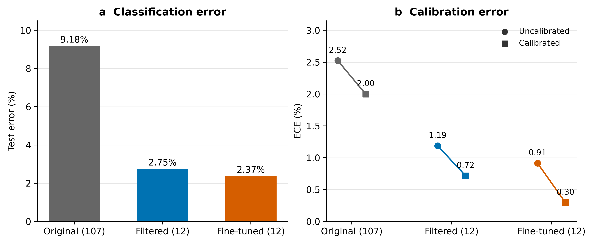
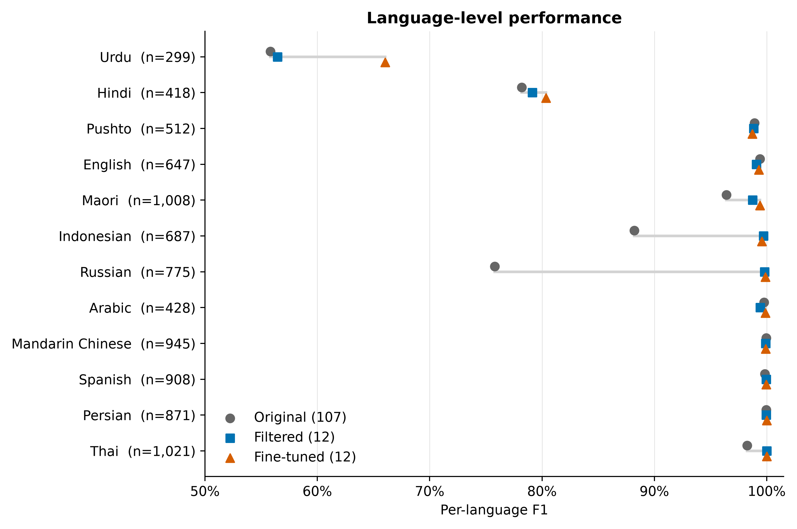
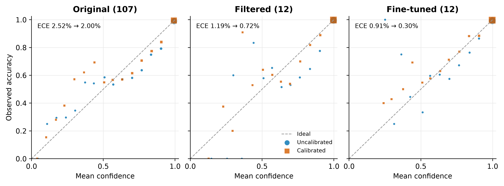

# Adapting SpeechBrain language identification to 12 languages

Experiment completed 22 October 2026. Percentages are rounded to two decimal places; **pp** means percentage points.

## Key findings

- **Filtering delivers most of the gain:** accuracy rises from **90.82% to 97.25%** (+6.43 pp), without retraining.
- **Fine-tuning improves accuracy to 97.63%** (+0.38 pp over filtering) and macro F1 to **95.25%**. Errors fall from 234 to 202 (13.7% relative reduction).
- **The calibrated fine-tuned head has the lowest ECE: 0.30%**, versus 0.72% for calibrated filtering.
- **Hindi–Urdu confusion dominates the residual errors:** 170/202 (84.2%) are predictions between this pair.

## Experiments and protocol

| Experiment | Modification | Training |
|---|---|---|
| Original (107) | Unmodified 107-language classifier | None |
| Filtered (12) | Select target logits, then softmax over the 12 languages | None |
| Fine-tuned (12) | Initialize from the pretrained classifier; retrain its MLP and 12-way output | Frozen ECAPA encoder; selected VoxLingua data |

- **Languages:** Arabic, English, Spanish, Persian, Hindi, Indonesian, Māori, Pushto, Russian, Thai, Urdu, Mandarin Chinese.
- **Base model:** `speechbrain/lang-id-voxlingua107-ecapa`; immutable model and dataset revisions are recorded in the linked provenance report.
- **Audio:** mono, 16 kHz; center crop to at most 10 seconds. Embeddings and original logits are cached once.
- **Head fitting:** 204,234 VoxLingua training clips; 23,607 validation clips. Source-video groups are disjoint between these splits.
- **Optimization:** RTX 3070 (8 GB); AdamW, learning rate 10⁻⁴, weight decay 10⁻⁴, batch size 256, inverse-frequency class weights, seed 42. Early stopping selects epoch 6 of 11 by VoxLingua validation NLL.
- **Calibration:** a separate scalar temperature for each model, fitted by NLL on **4,172 FLEURS validation recordings**; no FLEURS data used for head fitting or checkpoint selection.
- **Evaluation:** **8,519 FLEURS test recordings** across the selected languages. Accuracy is sample-weighted; precision, recall and F1 below are macro-averaged over the 12 target languages. Original-model predictions outside the target set count as errors.
- **ECE:** sample-weighted, top-label expected calibration error with 15 equal-width confidence bins; lower is better. Positive scalar temperature scaling leaves predicted labels unchanged.

## Overall performance

Classification metrics and ECE are percentages; temperature and NLL are unitless. Classification metrics are identical before and after temperature scaling.

| Model | Accuracy ↑ | Macro precision ↑ | Macro recall ↑ | Macro F1 ↑ |
|---|---:|---:|---:|---:|
| Original (107) | 90.82 | 95.75 | 88.28 | 90.87 |
| Filtered (12) | 97.25 | 95.46 | 94.32 | 94.25 |
| Fine-tuned (12) | 97.63 | 95.65 | 95.17 | 95.25 |

| Model | Temperature | ECE before ↓ | ECE after ↓ | NLL before ↓ | NLL after ↓ |
|---|---:|---:|---:|---:|---:|
| Original (107) | 1.143 | 2.52 | 2.00 | 0.2246 | 0.2254 |
| Filtered (12) | 1.406 | 1.19 | 0.72 | 0.0663 | 0.0649 |
| Fine-tuned (12) | 1.434 | 0.91 | 0.30 | 0.0670 | 0.0635 |

*Figure 1. Filtering sharply reduces classification error; fine-tuning adds a smaller gain. Temperature calibration reduces ECE for all three models. Both axes start at zero. ECE values are shown as percentages.*

- The original model predicts outside the allowed set on **6.74%** of test recordings. Restricting the output vocabulary removes these predictions by construction.
- Calibration improves test ECE for all models; original-model test NLL increases slightly despite fitting temperature on validation NLL. Calibration gains depend on the metric and evaluation distribution.

## Language-level effects

*Figure 2. Per-language F1, with test support in parentheses. The point-plot axis spans 50–100%; markers distinguish all three models. Temperature calibration does not change these scores.*

- **Filtering:** Russian F1 increases from 75.80% to 99.81%; Indonesian F1 from 88.20% to 99.71%.
- **Fine-tuning:** Urdu F1 increases by 9.58 pp and Māori F1 by 0.66 pp over filtering.
- **Trade-offs:** Hindi precision improves while recall falls; Urdu recall improves while precision falls. Pushto and Indonesian have small F1 declines after fine-tuning.

| Language | Model | Precision (%) | Recall (%) | F1 (%) |
|---|---|---:|---:|---:|
| Hindi | Filtered (12) | 69.11 | 92.58 | 79.14 |
| Hindi | Fine-tuned (12) | 73.90 | 88.04 | 80.35 |
| Urdu | Filtered (12) | 81.65 | 43.14 | 56.46 |
| Urdu | Fine-tuned (12) | 76.89 | 57.86 | 66.03 |

*Figure 3. Reliability diagrams using the same 15 bins as ECE. Each point is a nonempty bin; marker area is proportional to its sample count plus a visibility floor. The diagonal indicates ideal calibration. Sparse bins can be noisy; most recordings have high confidence.*

## Interpretation and scope

- **Filtering is a strong low-cost adaptation.** Fine-tuning offers a further accuracy/F1 gain, and its calibrated variant gives the best observed calibration.
- **Next experiment:** target Hindi–Urdu discrimination and test on deployment audio, including languages outside the selected set and silence.
- Results are from **one training seed and one benchmark**, with no uncertainty intervals or significance tests. The 0.38 pp fine-tuning gain is an observed difference, not a demonstrated generalization guarantee.
- This is a closed-set evaluation: no rejection policy was evaluated. FLEURS Arabic uses `ar_eg`, Spanish `es_419`, and Chinese `cmn_hans_cn`; conclusions are limited to these tested configurations.

## Artifacts and reproduction

- [Full metrics](../artifacts/full_run/comparison/summary.csv) · [Per-language metrics](../artifacts/full_run/comparison/per_language.csv) · [Detailed report and provenance](../artifacts/full_run/comparison/report.json).
- [Deployable SpeechBrain bundle](../artifacts/full_run/speechbrain_bundle/): calibration folded into classifier weights; offline loading and all 8,519 cached test predictions verified.
- Figures are supplied as **350 dpi PNG**, editable **SVG**, and vector **PDF** in [figures/](figures/). [Combined results CSV](overall_results.csv) preserves unrounded metrics as fractions.
- Regenerate this document, figures and results CSV with `uv run python scripts/write_experiment_report.py`. This reads saved results; it does not retrain or rerun evaluation.
