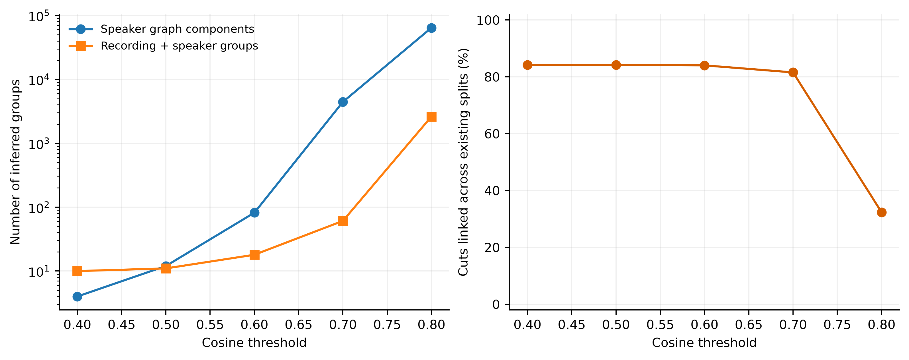
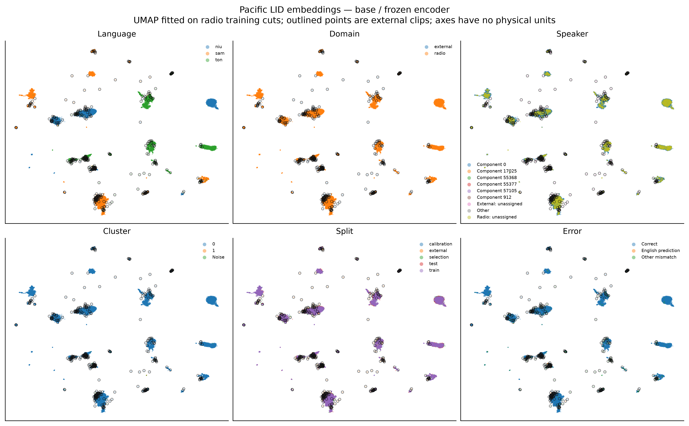
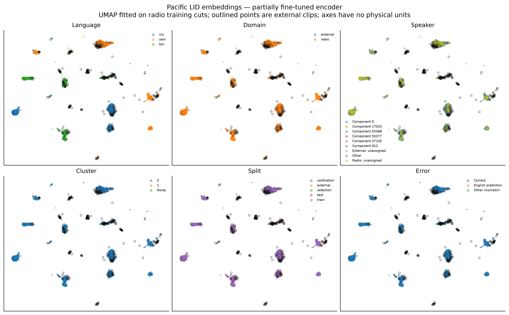
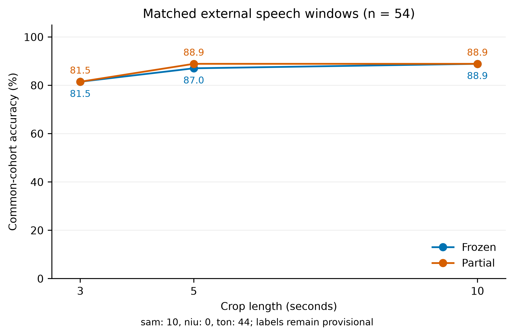

# Pacific speaker overlap and generalisation

## Findings

- Audited **44,822 radio cuts** using 90,855 speaker windows. External speaker matches are diagnostics only.
- At primary cosine threshold 0.5: **12 inferred speaker graph components**, 11 combined recording/speaker groups; largest combined group contains 44,762 cuts.
- **37,734 radio cuts** link to an inferred speaker component present in more than one original partition.
- These are automatic similarity groups, **not verified identities or proof of identity leakage**. False links and transitive chains can merge different people; missed links can split the same person.
- A collapsed graph across languages indicates that these permissive links cannot supply useful identity labels. This audit does not establish that the corpus contains too few genuine speakers. A validated matching threshold or a clustering method that limits transitive chaining is needed before claiming speaker-disjoint results.
- Of 10,000 randomly sampled cross-recording pairs within the largest speaker component, **93.0% have cosine similarity below 0.5** (median 0.126). This measures weak component cohesion, without establishing the pairs' true identities.

**Retraining stopped at the feasibility gate:** fewer than four independent groups for a language. No new classifiers were trained.

Existing external baseline: frozen: 68.87% conditional accuracy; partial: 71.23% conditional accuracy. [Full existing evaluation](../youtube_validation/held_out_evaluation.md). No model or temperature was fitted on these clips.

## Speaker audit

- Speaker encoder: `speechbrain/spkrec-ecapa-voxceleb`, pinned in [provenance](../../artifacts/speaker_study/speaker_identity.json). The separate LID model was not used to infer speakers.
- Full cuts → Silero speech detection → contiguous nonoverlapping 3-second windows → normalized speaker embeddings. Native audio level; no added gain normalization.
- Exact blockwise cosine threshold graphs, evaluated globally across languages. Recording and duplicate links are added when constructing partitions. No full quadratic distance matrix is retained.
- A cut with several inferred speakers links all of them. 7,108 radio/external cuts had no eligible 3-second speech window; these remain identity-uncertain. Unknown identities do not establish speaker independence.
- Thresholds are heuristic and have no manually measured false-match rate in these languages. A component is a group of potential matches, not a speaker-count estimate.
- Feasibility requires four independent groups and at least 50 cuts per language in each whole-group partition; targets are 80/5/5/10. Conservative grouping may prevent a valid split. We do not weaken thresholds after inspecting external performance.
- Speaker auditing and partition changes apply to the three Pacific languages. The original 12-language replay and FLEURS partitions are unchanged and are not speaker-audited in this study.

| Threshold | Speaker components | Components spanning original splits | Recording + speaker groups | Largest group cuts | Split feasible |
|---|---:|---:|---:|---:|---|
| 0.4 | 4 | 1 | 10 | 44,768 | No |
| 0.5 | 12 | 1 | 11 | 44,762 | No |
| 0.6 | 82 | 3 | 18 | 44,649 | No |
| 0.7 | 4,451 | 41 | 61 | 9,149 | Yes |
| 0.8 | 64,374 | 703 | 2,625 | 7,379 | Yes |

| Language | Independent groups at threshold 0.5 |
|---|---:|
| sam | 2 |
| niu | 1 |
| ton | 10 |

## LID embedding structure

- All Pacific radio cuts plus the fixed 428 external segments, separately for the base/frozen and existing partially fine-tuned encoder.
- UMAP: cosine metric, 30 neighbours, minimum distance 0.1, seed 42. Fit only on original radio training embeddings; transform all remaining points without language labels.
- Each encoder has an independent projection: axes, orientation and inter-cluster distances cannot be compared directly. A visible island is not proof of a true cluster.
- HDBSCAN is run on normalized embeddings reduced by training-fitted PCA50, **not on the 2D plot**. Minimum samples 10; minimum cluster sizes 25/50/100. Noise remains unassigned.
- Association scores below exclude HDBSCAN noise. Speaker associations use only radio cuts with a single assigned inferred speaker; unassigned and multiple-speaker cuts are excluded. Other attributes include external points. Scores are undefined if an attribute has fewer than two represented values. AMI adjusts for chance and is useful alongside NMI when recordings have many distinct IDs. Speaker labels inherit the automatic audit's uncertainty and the primary grouping's collapse makes speaker associations uninformative about genuine identities.
- Interactive views support colouring, domain filtering, pan/zoom, point metadata and local audio references. Open the HTML files locally with access to the original audio paths.

[Base/frozen interactive explorer](frozen_explorer.html) · [Partial interactive explorer](partial_explorer.html)

| Encoder | Attribute | NMI | AMI | Noise (%) |
|---|---|---:|---:|---:|
| frozen | language | 0.003 | 0.003 | 0.0 |
| frozen | speaker | 0.000 | -0.000 | 0.0 |
| frozen | recording | 0.002 | 0.001 | 0.0 |
| frozen | domain | 0.000 | 0.000 | 0.0 |
| partial | language | 0.003 | 0.003 | 0.0 |
| partial | speaker | 0.000 | -0.000 | 0.0 |
| partial | recording | 0.002 | 0.001 | 0.0 |
| partial | domain | 0.000 | 0.000 | 0.0 |

Clustering sensitivity is reported for every requested minimum cluster size. Large changes in cluster counts, noise and language association mean that the chosen clustering settings should not be read as a count of natural groups.

| Encoder | Minimum cluster size | Clusters | Noise (%) | Language NMI |
|---|---:|---:|---:|---:|
| frozen | 25 | 4 | 0.5 | 0.006 |
| frozen | 50 | 2 | 0.0 | 0.003 |
| frozen | 100 | 12 | 30.2 | 0.581 |
| partial | 25 | 3 | 0.7 | 0.004 |
| partial | 50 | 2 | 0.0 | 0.003 |
| partial | 100 | 10 | 20.3 | 0.644 |

## Paired duration diagnostic

Matched 3-, 5- and 10-second center crops of the same contiguous external speech windows. The common cohort excludes a parent window if any of the six model/crop combinations predicts English. These clips remain evaluation-only, with provisional folder labels; changing crop length can also change the amount of code-switching in a window.

| Model / crop | Paired windows | English exclusions | Conditional accuracy (%) | Common windows | Common accuracy (%) |
|---|---:|---:|---:|---:|---:|
| frozen_3s | 54 | 0 | 81.48 | 54 | 81.48 |
| frozen_5s | 54 | 0 | 87.04 | 54 | 87.04 |
| frozen_10s | 54 | 0 | 88.89 | 54 | 88.89 |
| partial_3s | 54 | 0 | 81.48 | 54 | 81.48 |
| partial_5s | 54 | 0 | 88.89 | 54 | 88.89 |
| partial_10s | 54 | 0 | 88.89 | 54 | 88.89 |

Eligible subset: **sam: 10, niu: 0, ton: 44**, from 7 source clips; **70.4%** of windows come from one source. This subset is not representative of the full external corpus; zero-count languages have no paired-duration evidence.

[Full duration metrics](../../artifacts/speaker_study/duration_metrics.json) · [Timestamped predictions](../../artifacts/speaker_study/duration_predictions.csv).

## Interpretation and next experiments

- Speaker-disjoint evaluation tests unseen-speaker robustness; changing the split alone does not guarantee better external performance. The number and balance of genuinely distinct speakers may be the limiting factor.
- Automatic groups cannot distinguish speaker identity from every channel, language or background effect. Review or labelled speaker pairs would be needed to validate the identities and tune a verification threshold.
- Preserve the external benchmark for evaluation. Its language labels remain provisional, English predictions are counted and excluded, and multiple cuts from one source are correlated. Current files may include overlapping extracts.
- Next priorities: manually labelled external speech; additional independent speakers and conversational styles; then separate noise/reverberation/codec augmentation ablations. Gain-only robustness was already tested and does not measure these effects.
- One training seed gives exploratory results without an estimate of training variance. Old-language regression remains part of every completed classifier comparison.
- These external clips have already informed experiment design. Treat them as development diagnostics and reserve fresh independent audio for a final generalisation claim.

## Artifacts

- [Per-cut inferred speaker labels](../../artifacts/speaker_study/speaker_labels.csv) · [Threshold sensitivity](../../artifacts/speaker_study/threshold_sensitivity.csv) · [External candidate matches](../../artifacts/speaker_study/external_speaker_matches.csv).
- [Base coordinates and metadata](../../artifacts/speaker_study/frozen_points.csv) · [Partial coordinates and metadata](../../artifacts/speaker_study/partial_points.csv).
- [Base cluster associations](../../artifacts/speaker_study/frozen_cluster_associations.csv) · [Partial cluster associations](../../artifacts/speaker_study/partial_cluster_associations.csv).
- Figures: PNG 350 dpi, PDF and SVG. Existing experiment results and source audio are preserved.
