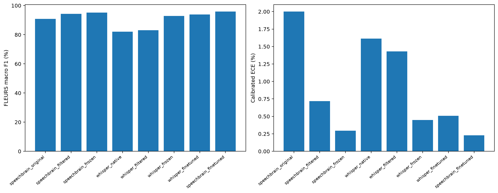

# Whisper tiny versus SpeechBrain: original twelve languages

Completed Whisper approaches: 3/3. The matched SpeechBrain full-encoder baseline is complete.

## Final findings

- Fine-tuning is the strongest Whisper approach: FLEURS accuracy 96.89%, macro F1 93.89% and calibrated ECE 0.51%.
- SpeechBrain leads on the broad twelve-language FLEURS test: its fine-tuned encoder reaches 97.78% accuracy and 95.83% macro F1, versus 96.89% / 93.89% for Whisper.
- The external Hindi/Thai sample reverses the fine-tuned-family ranking: Whisper scores 96.03% versus SpeechBrain 93.69% with English predictions excluded. On their shared cohort with all reference models, the scores are 96.20% / 93.59%.
- Filtered SpeechBrain still has the highest external Hindi/Thai accuracy: 97.20%. Thus the results do not identify one universally best approach across domains.
- External folder labels remain provisional and English exclusions can hide target-language errors. Consult all-segment scores and coverage as well as conditional accuracy. Pacific recognition is outside the twelve-language vocabulary.

## Protocol

Original VoxLingua recording-based train/selection manifests and exactly the original SpeechBrain cache IDs and language order are retained. No speaker separation or Pacific training data are used. Audio is mono 16 kHz and center-cropped to at most ten real seconds for both families. Whisper then applies its native 30-second right-zero-padding and log-mel frontend. It does not receive extra real audio.

Filtered Whisper uses the first decoder language-token logits after the start-of-transcript token. Non-language tokens are discarded, then the twelve selected language logits are renormalized with softmax. Native Whisper language recognition is also included as a reference.

Frozen Whisper features concatenate the mean and population standard deviation of encoder positions corresponding to real audio; right-padding outputs are excluded from pooling. The native attention still sees Whisper’s padded window. A LayerNorm/512-unit LeakyReLU/twelve-output classifier is learned from scratch. SpeechBrain’s existing frozen head benefits from pretrained classifier weights; the architectures and initialization histories differ.

The frozen head uses class-weighted cross-entropy over every original training example, batch 256, at most 30 epochs, learning rate 1e-4 and patience five, matching the existing SpeechBrain head protocol. Full encoder fine-tuning starts from each family’s best frozen head, uses identical seed-42 class-balanced example draws (32,768 per epoch), effective batch 32, head LR 1e-4, encoder LR 1e-5, at most 20 epochs and patience five. All encoder parameters train; SpeechBrain batch-normalization running statistics stay frozen for microbatch stability. These full-encoder references are separate from the historical fifteen-output partial-tail model.

Checkpoint selection minimizes unweighted VoxLingua validation NLL. Temperature scaling fits only on the original FLEURS validation IDs. FLEURS test and external clips are never used for training, checkpoint choice or temperature fitting. All methods retain every output in their declared vocabulary; out-of-set guesses count as errors on FLEURS.

## FLEURS twelve-language test

| Model | Test n | Accuracy | Macro precision | Macro recall | Macro F1 | ECE raw | ECE calibrated |
|---|---:|---:|---:|---:|---:|---:|---:|
| SpeechBrain original 107 | 8519 | 90.82 | 95.75 | 88.28 | 90.87 | 2.52 | 2.00 |
| SpeechBrain filtered 12 | 8519 | 97.25 | 95.46 | 94.32 | 94.25 | 1.19 | 0.72 |
| SpeechBrain frozen encoder + head | 8519 | 97.63 | 95.65 | 95.17 | 95.25 | 0.91 | 0.30 |
| Whisper tiny native languages | 8519 | 86.86 | 87.86 | 81.75 | 82.15 | 1.92 | 1.61 |
| Whisper tiny filtered 12 | 8519 | 90.20 | 86.13 | 84.81 | 83.06 | 1.74 | 1.43 |
| Whisper frozen encoder + head | 8519 | 96.22 | 93.58 | 92.71 | 92.87 | 0.41 | 0.45 |
| Whisper full encoder fine-tuned + head | 8519 | 96.89 | 94.23 | 93.81 | 93.89 | 1.84 | 0.51 |
| SpeechBrain full encoder fine-tuned + head | 8519 | 97.78 | 95.84 | 95.85 | 95.83 | 0.87 | 0.23 |

## Paired approaches

| Approach | Whisper accuracy / F1 | SpeechBrain accuracy / F1 |
|---|---|---|
| Filtering | 90.20 / 83.06 | 97.25 / 94.25 |
| Frozen encoder + head | 96.22 / 92.87 | 97.63 / 95.25 |
| Full fine-tuned encoder + head | 96.89 / 93.89 | 97.78 / 95.83 |

## External Hindi and Thai

Same saved 3–10-second VAD segments for every model. Folder labels are provisional and code-switching is unannotated. All-segment accuracy counts English predictions as errors; conditional scores exclude them and show coverage. The shared cohort excludes the union of English predictions from all currently completed models, so its size can change while training is incomplete.

| Model | All accuracy | Conditional accuracy | Macro F1 (conditional) | English excluded | Coverage | Common accuracy |
|---|---:|---:|---:|---:|---:|---:|
| SpeechBrain original 107 | 85.57 | 96.06 | 98.34 | 53 | 89.07 | 96.91 |
| SpeechBrain filtered 12 | 85.77 | 97.20 | 98.98 | 57 | 88.25 | 97.15 |
| SpeechBrain frozen encoder + head | 82.89 | 94.15 | 97.83 | 58 | 88.04 | 94.06 |
| Whisper tiny native languages | 78.14 | 89.18 | 95.30 | 60 | 87.63 | 89.79 |
| Whisper tiny filtered 12 | 79.59 | 91.25 | 96.16 | 62 | 87.22 | 91.45 |
| Whisper frozen encoder + head | 83.51 | 93.97 | 97.54 | 54 | 88.87 | 95.25 |
| Whisper full encoder fine-tuned + head | 84.74 | 96.03 | 98.54 | 57 | 88.25 | 96.20 |
| SpeechBrain full encoder fine-tuned + head | 82.68 | 93.69 | 97.64 | 57 | 88.25 | 93.59 |

| Model | Language | Cuts | English excluded | Conditional accuracy |
|---|---|---:|---:|---:|
| SpeechBrain original 107 | hi | 304 | 2 | 95.03 |
| SpeechBrain original 107 | th | 181 | 51 | 98.46 |
| SpeechBrain filtered 12 | hi | 304 | 4 | 96.00 |
| SpeechBrain filtered 12 | th | 181 | 53 | 100.00 |
| SpeechBrain frozen encoder + head | hi | 304 | 4 | 91.67 |
| SpeechBrain frozen encoder + head | th | 181 | 54 | 100.00 |
| Whisper tiny native languages | hi | 304 | 6 | 86.24 |
| Whisper tiny native languages | th | 181 | 54 | 96.06 |
| Whisper tiny filtered 12 | hi | 304 | 8 | 88.85 |
| Whisper tiny filtered 12 | th | 181 | 54 | 96.85 |
| Whisper frozen encoder + head | hi | 304 | 3 | 92.03 |
| Whisper frozen encoder + head | th | 181 | 51 | 98.46 |
| Whisper full encoder fine-tuned + head | hi | 304 | 4 | 94.33 |
| Whisper full encoder fine-tuned + head | th | 181 | 53 | 100.00 |
| SpeechBrain full encoder fine-tuned + head | hi | 304 | 4 | 91.00 |
| SpeechBrain full encoder fine-tuned + head | th | 181 | 53 | 100.00 |

## Pacific out-of-set diagnostics

The requested twelve-language classifiers do not contain Samoan, Niuean or Tongan outputs. They cannot be assigned meaningful Pacific recognition accuracy. Prediction counts and confidence on the same Pacific clips are reported separately; forced-choice confidence is not an unknown-language rejection policy. A fifteen-language Whisper extension would be a separate experiment.

[Out-of-set predictions](../../artifacts/whisper_tiny12/pacific_out_of_set.csv).

## Duration and gain diagnostics

Nested 3/5/10-second crops from identical ten-second contiguous VAD windows compare duration effects. A separate ±12 dB gain probe uses only original VoxLingua checkpoint-selection audio, with amplification capped to avoid clipping. These probes are diagnostic and never select preprocessing or models. No noise-augmentation benefit is inferred from a uniform-gain test.

Diagnostics complete; see the CSV artifacts.

### Completed diagnostic results

All-segment accuracy on the same 210 eligible Hindi/Thai ten-second speech windows, cropped to each duration. Crop content and code-switch proportions can change with duration; this is not a new preprocessing selection experiment.

| Model | 3 seconds | 5 seconds | 10 seconds |
|---|---:|---:|---:|
| Whisper tiny filtered 12 | 77.14 | 82.86 | 86.67 |
| Whisper frozen encoder + head | 82.86 | 91.43 | 88.57 |
| Whisper full encoder fine-tuned + head | 85.71 | 90.48 | 86.67 |
| SpeechBrain filtered 12 | 85.71 | 87.62 | 88.57 |
| SpeechBrain frozen encoder + head | 81.90 | 84.29 | 86.67 |
| SpeechBrain full encoder fine-tuned + head | 82.38 | 84.76 | 88.10 |

Gain probes count changed top-1 predictions relative to the unchanged waveform; a change is not necessarily an error. Positive gain is capped to prevent clipping, so the applied amplification can be less than +12 dB.

| Model | Changes at −12 dB | Changes at capped +12 dB |
|---|---:|---:|
| Whisper tiny filtered 12 | 2/144 | 4/144 |
| Whisper frozen encoder + head | 2/144 | 0/144 |
| Whisper full encoder fine-tuned + head | 6/144 | 0/144 |
| SpeechBrain filtered 12 | 0/144 | 0/144 |
| SpeechBrain frozen encoder + head | 0/144 | 0/144 |
| SpeechBrain full encoder fine-tuned + head | 0/144 | 0/144 |

SpeechBrain was invariant in these gain probes. Whisper was somewhat more gain-sensitive, especially after fine-tuning at reduced volume. Uniform-gain tests do not measure additive-noise robustness.

## Interpretation and limits

All three Whisper approaches and the matched SpeechBrain full-encoder reference have finished. Rankings are descriptive, with one training seed. Pretraining corpora, frontends, head initialization and encoder architecture differ; pretraining overlap with evaluation speakers cannot be ruled out.

Configuration, package lock, model checksum, immutable cohort manifests, sharded caches, checkpoints and resource measurements are under `artifacts/whisper_tiny12`. Runtime limits are 4 GiB host RAM, zero swap, two CPU equivalents, one GPU job, and a sub-7 GiB GPU preflight.

- [Full FLEURS metrics](../../artifacts/whisper_tiny12/fleurs_summary.csv) · [Per-language FLEURS metrics](../../artifacts/whisper_tiny12/fleurs_per_language.csv).
- [External metrics](../../artifacts/whisper_tiny12/external_summary.csv) · [Per-language external metrics](../../artifacts/whisper_tiny12/external_per_language.csv) · [All external predictions](../../artifacts/whisper_tiny12/external_predictions.csv).
- [Duration diagnostics](../../artifacts/whisper_tiny12/diagnostics/duration.csv) · [Gain diagnostics](../../artifacts/whisper_tiny12/diagnostics/gain.csv) · [Diagnostic predictions](../../artifacts/whisper_tiny12/diagnostics/predictions.csv).
- [Configuration](../../artifacts/whisper_tiny12/configuration.json) · [Data identity](../../artifacts/whisper_tiny12/data_ready.json) · [Model identity](../../artifacts/whisper_tiny12/model_identity.json).

Whisper implementation references: [native language-token detection](https://github.com/openai/whisper/blob/v20250625/whisper/decoding.py), [native padding and log-mel frontend](https://github.com/openai/whisper/blob/v20250625/whisper/audio.py).

