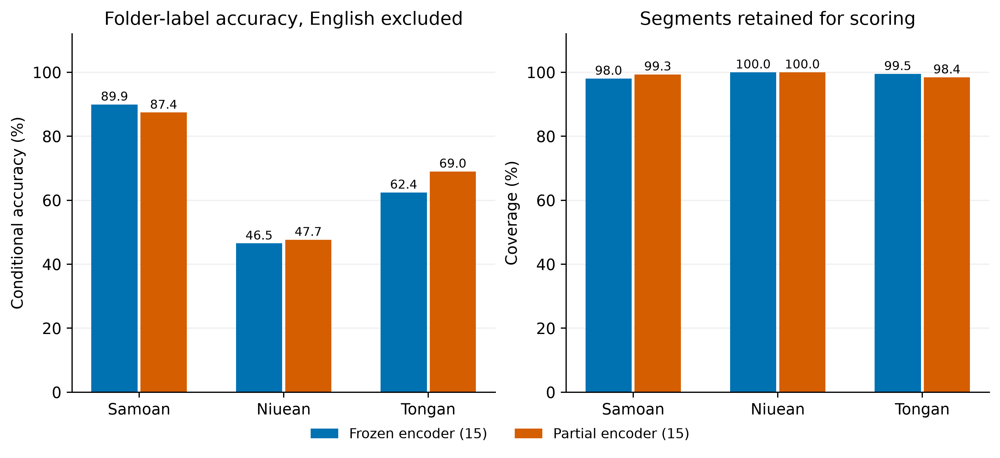
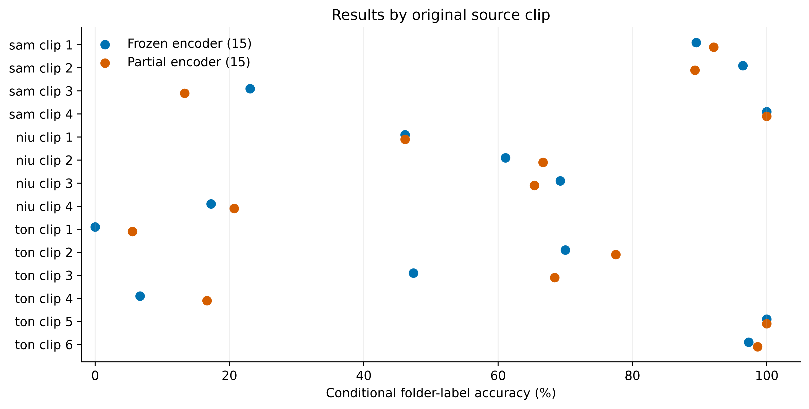

# Held-out YouTube speech evaluation

**Purpose:** screen for generalization beyond the radio-news training domain. These are **provisional directory-label metrics**, not a manually annotated conversational benchmark.

## Key findings

- **Conditional accuracy is 68.87% (frozen) and 71.23% (partial)**, compared with about 99.7–99.8% on the radio-news new-language holdout. These datasets/protocols differ, so this does not isolate the cause of the difference.
- **English exclusions:** 4 / 4 segments. On the identical 422-segment cohort, accuracy is 68.96% / 71.56%.
- **Per-language accuracy:** Tongan 62.43% / 68.98%; Niuean 46.51% / 47.67%; Samoan 89.93% / 87.42% (frozen / partial).
- **Equal weighting of source clips gives lower accuracy:** 58.86% / 61.46%. Long, easier clips can raise pooled accuracy while performance on individual sources remains uneven.
- **Prioritize review and independent evaluation sources for Niuean and Tongan**, the weaker languages in this collection. Test noise/channel/reverberation augmentation as an ablation only if annotated errors support an acoustic mismatch. These results do not establish that augmentation alone will fix the difference.

## Change from the original seven-clip evaluation

Same model checkpoints and VAD settings; the evaluation corpus changed. Differences below reflect audio composition, not model improvement.

| Model | Previous cuts | Updated cuts | Previous accuracy (%) | Updated accuracy (%) | Previous English | Updated English |
|---|---:|---:|---:|---:|---:|---:|
| Frozen encoder (15) | 162 | 428 | 65.22 | 68.87 | 1 | 4 |
| Partial encoder (15) | 162 | 428 | 68.12 | 71.23 | 2 | 4 |

[Previous report](../youtube_validation_previous_7clips/held_out_evaluation.md).

## Data and segmentation

- **14 source clips**, 71.6 minutes; folder labels `sam`, `niu`, `ton`. The directory spelling `Nuiean` maps to Niuean (`niu`). This is a mixed convenience sample; recording styles are not manually annotated.
- Silero VAD 6.2.3 on CPU; threshold 0.5, minimum silence 300 ms, padding 150 ms. [Model implementation](https://github.com/snakers4/silero-vad).
- Decode one file at a time to mono 16 kHz float32. Keep contiguous **3–10 second** speech segments; split long regions evenly without overlap or concatenating distant speech. Discard regions below 3 seconds.
- **428 retained segments**, 37.6 minutes; **612 short regions discarded**. Detailed VAD boundaries and discarded durations are saved per source.
- No extra gain normalization, model fitting, augmentation, checkpoint selection, or temperature fitting used these clips. Apply previously fitted radio/FLEURS calibration once; raw/calibrated top-1 labels agree.

| Source audio | Label | Duration (s) | Retained cuts | Retained (s) | Short regions dropped |
|---|---|---:|---:|---:|---:|
| muss-ma-le-fa-asoa-auoooooola-ua-uma-upu-ae-taunuu-musstheman78_7zLrpyjK.mp3 | sam | 400.4 | 38 | 201.9 | 77 |
| oct-22-2026-ep173-lalaga-alofa-by-su-a-andrew-leota-leuluaialii-muavaa_NZ0qkOn4.mp3 | sam | 291.5 | 28 | 116.2 | 56 |
| samoan_language_week.wav | sam | 129.8 | 16 | 82.8 | 18 |
| samoan_tv_long.wav | sam | 426.0 | 70 | 385.9 | 12 |
| 10-talking-to-nena-tutala-ki-a-nena-niue_Jf3qRCTf.mp3 | niu | 105.4 | 13 | 52.6 | 14 |
| 22-mum-s-octopus-ko-e-feke-ha-mami-niue_RgwdRyES.mp3 | niu | 237.7 | 18 | 66.0 | 44 |
| 23-that-s-the-way-kia-eketaha-niue_EMIhO9ef.mp3 | niu | 295.8 | 26 | 114.6 | 57 |
| Niuean.wav | niu | 210.9 | 29 | 119.0 | 20 |
| 1st-place-year-13-lea-faka-tonga-speech-polyfest-2013_yVpmU9mO.mp3 | ton | 297.0 | 20 | 107.7 | 48 |
| Tongan.wav | ton | 730.1 | 40 | 166.8 | 173 |
| melenaite-lutui-tongan-speech-polyfest-2026_jWBDXS5X.mp3 | ton | 239.6 | 19 | 75.7 | 63 |
| tongan_language_week.wav | ton | 277.0 | 30 | 153.8 | 22 |
| tongan_tv.wav | ton | 60.0 | 7 | 53.4 | 1 |
| tongan_tv_long.wav | ton | 593.0 | 74 | 560.1 | 7 |

## English-excluded results

- Count every top-1 **English prediction** separately and exclude it from that model's accuracy, precision, recall, F1 and ECE. Other predicted languages remain errors against the folder label.
- **English predictions are not verified English speech.** A missed Pacific-language segment predicted English is excluded too; actual English predicted as a Pacific language can remain in the metrics. Mixed-language segments also have no verified language label.
- Denominators therefore differ by model. Coverage and the same-cohort comparison below are essential for interpreting scores. Precision/recall/F1 are macro-averaged across target languages with retained ground-label examples; empty cohorts have undefined scores.

| Model | Cuts | English excluded | Scored | Coverage (%) | Accuracy (%) | Precision (%) | Recall (%) | F1 (%) |
|---|---:|---:|---:|---:|---:|---:|---:|---:|
| Frozen encoder (15) | 428 | 4 | 424 | 99.07 | 68.87 | 80.66 | 66.29 | 71.95 |
| Partial encoder (15) | 428 | 4 | 424 | 99.07 | 71.23 | 84.78 | 68.03 | 74.41 |

### Same-cohort comparison

Exclude a segment if **either** 15-language model predicts English, then compare both on the identical remaining segments. This controls differences in model-specific exclusion sets; it does not establish their true language. Source accuracy is the unweighted mean of clip-level conditional accuracies for clips with retained segments.

| Model | Common cuts | Accuracy (%) | Macro F1 (%) | Mean source accuracy (%) |
|---|---:|---:|---:|---:|
| Frozen encoder (15) | 422 | 68.96 | 71.95 | 58.86 |
| Partial encoder (15) | 422 | 71.56 | 74.61 | 61.60 |

### By language and source

| Model | Folder label | Cuts | English excluded | Scored | Accuracy (%) |
|---|---|---:|---:|---:|---:|
| Frozen encoder (15) | sam | 152 | 3 | 149 | 89.93 |
| Frozen encoder (15) | niu | 86 | 0 | 86 | 46.51 |
| Frozen encoder (15) | ton | 190 | 1 | 189 | 62.43 |
| Partial encoder (15) | sam | 152 | 1 | 151 | 87.42 |
| Partial encoder (15) | niu | 86 | 0 | 86 | 47.67 |
| Partial encoder (15) | ton | 190 | 3 | 187 | 68.98 |

### Segment-duration diagnostic

Descriptive scores after English exclusions; duration is another possible contributor to the gap and was not tuned using these results. Bins start at the configured minimum, with boundaries at 5, 8, and 10 seconds; upper boundaries are excluded except the final 10-second boundary.

| Model | Duration (s) | Scored cuts | Accuracy (%) |
|---|---:|---:|---:|
| Frozen encoder (15) | 3–5 | 230 | 59.57 |
| Frozen encoder (15) | 5–8 | 133 | 74.44 |
| Frozen encoder (15) | 8–10 | 61 | 91.80 |
| Partial encoder (15) | 3–5 | 230 | 62.61 |
| Partial encoder (15) | 5–8 | 133 | 74.44 |
| Partial encoder (15) | 8–10 | 61 | 96.72 |

### Largest non-English mismatches

| Model | Folder label | Predicted | Segments |
|---|---|---|---:|
| Frozen encoder (15) | niu | ton | 37 |
| Frozen encoder (15) | ton | mi | 25 |
| Frozen encoder (15) | ton | id | 15 |
| Frozen encoder (15) | ton | sam | 12 |
| Frozen encoder (15) | ton | niu | 10 |
| Partial encoder (15) | niu | ton | 41 |
| Partial encoder (15) | ton | mi | 25 |
| Partial encoder (15) | ton | id | 11 |
| Partial encoder (15) | ton | sam | 9 |
| Partial encoder (15) | sam | mi | 9 |

### Calibration diagnostics

ECE uses 15 equal-width bins on each model's non-English subset. These values are conditional and use provisional labels; they are not an unbiased calibration estimate for verified code-switched speech.

| Model | Raw ECE (%) | Previously calibrated ECE (%) | Temperature |
|---|---:|---:|---:|
| Frozen encoder (15) | 15.00 | 11.63 | 1.273 |
| Partial encoder (15) | 14.55 | 10.77 | 1.249 |

### Older model controls

The original 107-language, filtered 12-language, and previous fine-tuned 12-language classifiers **lack all three target outputs**. Their target-language accuracy/F1 is structurally zero on retained folder labels, so they are reference controls rather than competing recognition models. Their English counts and error-label distributions are still useful.

| Control | English predictions | Non-English cuts | Most frequent predictions (all cuts) |
|---|---:|---:|---|
| Original (107) | 7 | 421 | mi: 164, haw: 41, sw: 40, jw: 31 |
| Filtered (12) | 22 | 406 | mi: 299, id: 29, en: 22, th: 17 |
| Previous fine-tuned (12) | 16 | 412 | mi: 335, id: 30, en: 16, es: 14 |

## Interpretation and next experiment

- Compare conditional accuracy **with coverage and per-source results**, rather than treating all retained cuts as independent evidence. Source-file counts are {'sam': 4, 'niu': 4, 'ton': 6}; files do not establish independent speakers or videos, and short/long extracts may overlap. No narrow segment-level confidence intervals are reported.
- The radio-held-out test previously gave approximately 99.7–99.8% accuracy on the three new languages. These YouTube scores use different audio, segment durations and English exclusions; the difference is a domain-shift diagnostic, not a controlled estimate of augmentation benefit.
- Manually review English predictions, disagreements and non-English mismatches using the timestamped review queue before deciding which errors are acoustic domain shift versus label uncertainty or code switching.
- If verified errors cluster around noise, room acoustics or recording channels, test corresponding augmentation as a controlled training ablation with old-language replay. If they cluster around conversational pronunciation or speaking style, prioritize additional independent conversational speakers. Keep these evaluation sources held out from that training.
- Gain-only augmentation is unlikely to resolve a speaking-style mismatch by itself; the prior Samoan validation gain probe showed nearly invariant embeddings under uniform gain changes. This is a working hypothesis to test, not a measured augmentation result.

## Artifacts

- [Summary CSV](../../artifacts/youtube_validation_v2/summary.csv) · [Per-language CSV](../../artifacts/youtube_validation_v2/per_language.csv) · [Per-source CSV](../../artifacts/youtube_validation_v2/per_source.csv).
- [Every prediction and probability](../../artifacts/youtube_validation_v2/predictions.csv) · [Full report JSON](../../artifacts/youtube_validation_v2/report.json).
- [Review queue](../../artifacts/youtube_validation_v2/review_queue.csv) · [Annotation template](../../artifacts/youtube_validation_v2/annotations_template.csv) · [Speech WAVs](../../artifacts/youtube_validation_v2/segments/).
- Source/model/VAD hashes, exact boundaries and settings are recorded. Plots are 350 dpi PNG plus vector PDF and SVG.
