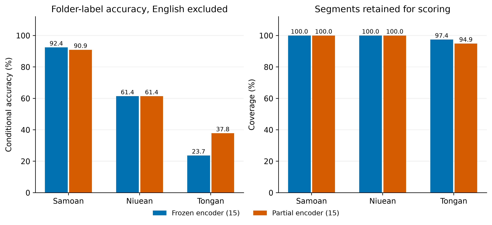
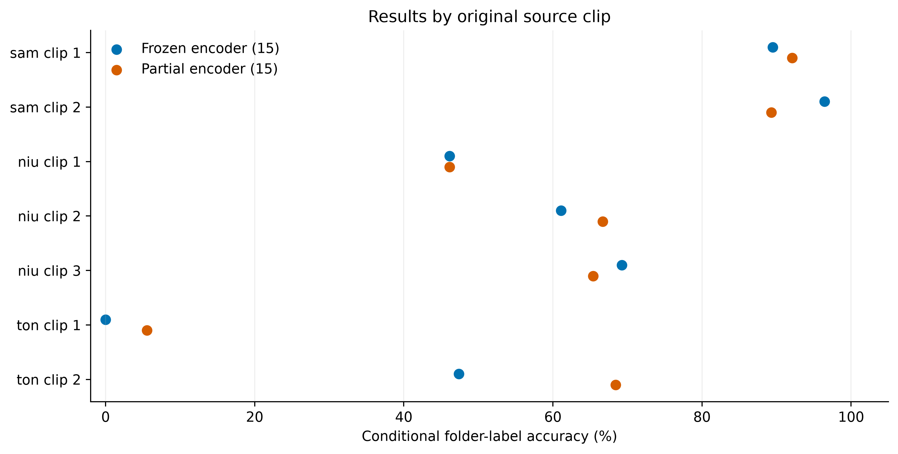

# Held-out YouTube speech evaluation

**Purpose:** screen for generalization beyond the radio-news training domain. These are **provisional directory-label metrics**, not a manually annotated conversational benchmark.

## Key findings

- **There is a substantial observed generalization gap on these clips:** conditional accuracy is **65.22%** (frozen) and **68.12%** (partial), compared with about 99.7–99.8% on the radio-news new-language holdout. These datasets/protocols differ, so this does not isolate the cause.
- **English exclusions do not explain the gap:** only 1 / 2 segments are excluded. On the identical 160-segment cohort, accuracy is 65.62% / 68.12%.
- **Tongan is the weakest language:** 23.68% / 37.84%; Niuean is 61.40% / 61.40%; Samoan is 92.42% / 90.91% (frozen / partial).
- **Prioritize independent Tongan and Niuean conversational/public-speaking sources and review the failing clips.** Then test noise/channel/reverberation augmentation as an ablation if annotated errors support an acoustic mismatch. These results do not establish that augmentation alone will fix the gap.

## Data and segmentation

- **7 source clips**, 31.1 minutes; folder labels `sam`, `niu`, `ton`. The directory spelling `Nuiean` maps to Niuean (`niu`). Clips include public speeches and conversational-style material; this is a small convenience sample.
- Silero VAD 6.2.3 on CPU; threshold 0.5, minimum silence 300 ms, padding 150 ms. [Model implementation](https://github.com/snakers4/silero-vad).
- Decode one file at a time to mono 16 kHz float32. Keep contiguous **3–10 second** speech segments; split long regions evenly without overlap or concatenating distant speech. Discard regions below 3 seconds.
- **162 retained segments**, 12.2 minutes; **359 short regions discarded**. Detailed VAD boundaries and discarded durations are saved per source.
- No extra gain normalization, model fitting, augmentation, checkpoint selection, or temperature fitting used these clips. Apply previously fitted radio/FLEURS calibration once; raw/calibrated top-1 labels agree.

| Source MP3 | Label | Duration (s) | Retained cuts | Retained (s) | Short regions dropped |
|---|---|---:|---:|---:|---:|
| muss-ma-le-fa-asoa-auoooooola-ua-uma-upu-ae-taunuu-musstheman78_7zLrpyjK.mp3 | sam | 400.4 | 38 | 201.9 | 77 |
| oct-22-2026-ep173-lalaga-alofa-by-su-a-andrew-leota-leuluaialii-muavaa_NZ0qkOn4.mp3 | sam | 291.5 | 28 | 116.2 | 56 |
| 10-talking-to-nena-tutala-ki-a-nena-niue_Jf3qRCTf.mp3 | niu | 105.4 | 13 | 52.6 | 14 |
| 22-mum-s-octopus-ko-e-feke-ha-mami-niue_RgwdRyES.mp3 | niu | 237.7 | 18 | 66.0 | 44 |
| 23-that-s-the-way-kia-eketaha-niue_EMIhO9ef.mp3 | niu | 295.8 | 26 | 114.6 | 57 |
| 1st-place-year-13-lea-faka-tonga-speech-polyfest-2013_yVpmU9mO.mp3 | ton | 297.0 | 20 | 107.7 | 48 |
| melenaite-lutui-tongan-speech-polyfest-2026_jWBDXS5X.mp3 | ton | 239.6 | 19 | 75.7 | 63 |

## English-excluded results

- Count every top-1 **English prediction** separately and exclude it from that model's accuracy, precision, recall, F1 and ECE. Other predicted languages remain errors against the folder label.
- **English predictions are not verified English speech.** A missed Pacific-language segment predicted English is excluded too; actual English predicted as a Pacific language can remain in the metrics. Mixed-language segments also have no verified language label.
- Denominators therefore differ by model. Coverage and the same-cohort comparison below are essential for interpreting scores. Precision/recall/F1 are macro-averaged across target languages with retained ground-label examples; empty cohorts have undefined scores.

| Model | Cuts | English excluded | Scored | Coverage (%) | Accuracy (%) | Precision (%) | Recall (%) | F1 (%) |
|---|---:|---:|---:|---:|---:|---:|---:|---:|
| Frozen encoder (15) | 162 | 1 | 161 | 99.38 | 65.22 | 74.96 | 59.17 | 65.36 |
| Partial encoder (15) | 162 | 2 | 160 | 98.77 | 68.12 | 77.69 | 63.38 | 68.98 |

### Same-cohort comparison

Exclude a segment if **either** 15-language model predicts English, then compare both on the identical remaining segments. This controls differences in model-specific exclusion sets; it does not establish their true language. Source accuracy is the unweighted mean of clip-level conditional accuracies for clips with retained segments.

| Model | Common cuts | Accuracy (%) | Macro F1 (%) | Mean source accuracy (%) |
|---|---:|---:|---:|---:|
| Frozen encoder (15) | 160 | 65.62 | 65.50 | 58.54 |
| Partial encoder (15) | 160 | 68.12 | 68.98 | 61.94 |

### By language and source

| Model | Folder label | Cuts | English excluded | Scored | Accuracy (%) |
|---|---|---:|---:|---:|---:|
| Frozen encoder (15) | sam | 66 | 0 | 66 | 92.42 |
| Frozen encoder (15) | niu | 57 | 0 | 57 | 61.40 |
| Frozen encoder (15) | ton | 39 | 1 | 38 | 23.68 |
| Partial encoder (15) | sam | 66 | 0 | 66 | 90.91 |
| Partial encoder (15) | niu | 57 | 0 | 57 | 61.40 |
| Partial encoder (15) | ton | 39 | 2 | 37 | 37.84 |

### Segment-duration diagnostic

Descriptive scores after English exclusions; duration is another possible contributor to the gap and was not tuned using these results. Bins start at the configured minimum, with boundaries at 5, 8, and 10 seconds; upper boundaries are excluded except the final 10-second boundary.

| Model | Duration (s) | Scored cuts | Accuracy (%) |
|---|---:|---:|---:|
| Frozen encoder (15) | 3–5 | 114 | 62.28 |
| Frozen encoder (15) | 5–8 | 40 | 70.00 |
| Frozen encoder (15) | 8–10 | 7 | 85.71 |
| Partial encoder (15) | 3–5 | 114 | 65.79 |
| Partial encoder (15) | 5–8 | 39 | 71.79 |
| Partial encoder (15) | 8–10 | 7 | 85.71 |

### Largest non-English mismatches

| Model | Folder label | Predicted | Segments |
|---|---|---|---:|
| Frozen encoder (15) | niu | ton | 16 |
| Frozen encoder (15) | ton | mi | 11 |
| Frozen encoder (15) | ton | id | 10 |
| Frozen encoder (15) | ton | zh | 4 |
| Frozen encoder (15) | sam | ton | 4 |
| Partial encoder (15) | niu | ton | 19 |
| Partial encoder (15) | ton | id | 9 |
| Partial encoder (15) | ton | mi | 6 |
| Partial encoder (15) | ton | zh | 5 |
| Partial encoder (15) | sam | ton | 4 |

### Calibration diagnostics

ECE uses 15 equal-width bins on each model's non-English subset. These values are conditional and use provisional labels; they are not an unbiased calibration estimate for verified code-switched speech.

| Model | Raw ECE (%) | Previously calibrated ECE (%) | Temperature |
|---|---:|---:|---:|
| Frozen encoder (15) | 16.48 | 14.24 | 1.273 |
| Partial encoder (15) | 15.42 | 10.65 | 1.249 |

### Older model controls

The original 107-language, filtered 12-language, and previous fine-tuned 12-language classifiers **lack all three target outputs**. Their target-language accuracy/F1 is structurally zero on retained folder labels, so they are reference controls rather than competing recognition models. Their English counts and error-label distributions are still useful.

| Control | English predictions | Non-English cuts | Most frequent predictions (all cuts) |
|---|---:|---:|---|
| Original (107) | 3 | 159 | mi: 61, jw: 18, sw: 10, pt: 9 |
| Filtered (12) | 8 | 154 | mi: 112, id: 15, th: 10, en: 8 |
| Previous fine-tuned (12) | 7 | 155 | mi: 123, id: 16, en: 7, es: 5 |

## Interpretation and next experiment

- Compare conditional accuracy **with coverage and per-source results**, rather than treating all retained cuts as independent evidence. There are only two or three original clips per language; no narrow segment-level confidence intervals are reported.
- The radio-held-out test previously gave approximately 99.7–99.8% accuracy on the three new languages. These YouTube scores use different audio, segment durations and English exclusions; the difference is a domain-shift diagnostic, not a controlled estimate of augmentation benefit.
- Manually review English predictions, disagreements and non-English mismatches using the timestamped review queue before deciding which errors are acoustic domain shift versus label uncertainty or code switching.
- If verified errors cluster around noise, room acoustics or recording channels, test corresponding augmentation as a controlled training ablation with old-language replay. If they cluster around conversational pronunciation or speaking style, prioritize additional independent conversational speakers. Keep these evaluation sources held out from that training.
- Gain-only augmentation is unlikely to resolve a speaking-style mismatch by itself; the prior Samoan validation gain probe showed nearly invariant embeddings under uniform gain changes. This is a working hypothesis to test, not a measured augmentation result.

## Artifacts

- [Summary CSV](../../artifacts/youtube_validation/summary.csv) · [Per-language CSV](../../artifacts/youtube_validation/per_language.csv) · [Per-source CSV](../../artifacts/youtube_validation/per_source.csv).
- [Every prediction and probability](../../artifacts/youtube_validation/predictions.csv) · [Full report JSON](../../artifacts/youtube_validation/report.json).
- [Review queue](../../artifacts/youtube_validation/review_queue.csv) · [Annotation template](../../artifacts/youtube_validation/annotations_template.csv) · [Speech WAVs](../../artifacts/youtube_validation/segments/).
- Source/model/VAD hashes, exact boundaries and settings are recorded. Plots are 350 dpi PNG plus vector PDF and SVG.
