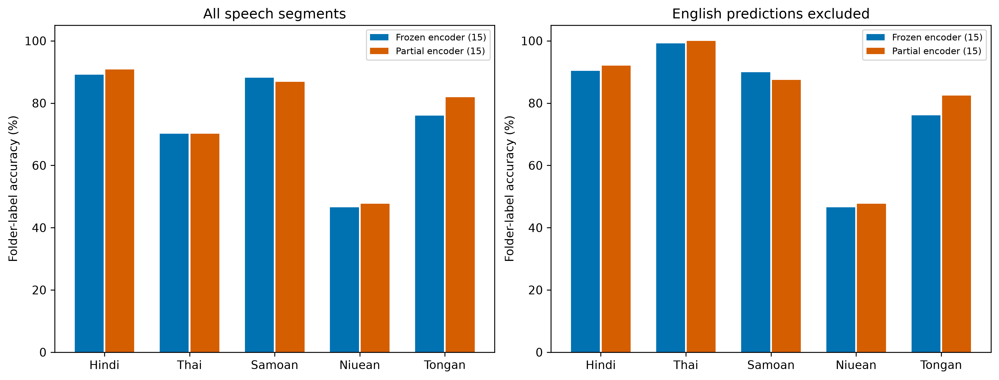
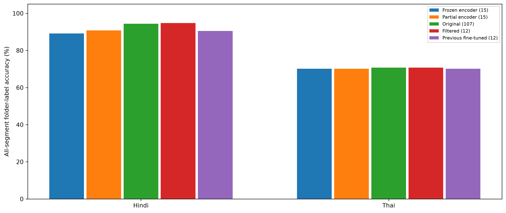
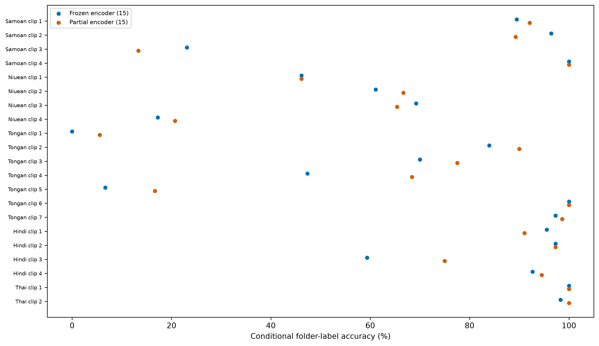

# Expanded external validation: original and Pacific languages

All models use the original recording-based training sets. No speaker-separated checkpoint is used, and the stopped speaker-split worker remains stopped. This run performs inference only: no retraining, checkpoint selection or calibration fitting on these clips.

Folder labels are provisional. Code-switching, translations, music and errors in folder labels have not been manually annotated. All-segment scores count English predictions as errors against the folder label; conditional scores exclude them, matching the previous policy. Coverage is reported because exclusions may hide both real English and target-language errors.

## Validation corpus

21 source files; 178.8 minutes before VAD; 1243 retained 3–10-second speech segments (130.9 minutes). VAD, decoding and crop settings are identical across models. Ordinary source clips may overlap or share speakers; segment counts are not independent sample counts.

| Language | Source files | Retained segments | Retained minutes |
|---|---:|---:|---:|
| Hindi | 4 | 304 | 37.5 |
| Thai | 2 | 181 | 22.1 |
| Samoan | 4 | 152 | 13.1 |
| Niuean | 4 | 86 | 5.9 |
| Tongan | 7 | 520 | 52.3 |

## Group comparisons

All values below are percentages. Macro metrics use only the group’s folder labels while retaining all model outputs as possible predictions. Source mean weights each source file equally, whereas pooled accuracy weights each segment equally. Unsupported model/language combinations are not treated as valid zero-accuracy baselines.

### Original-language sample: Hindi and Thai

| Model | All accuracy | Conditional accuracy | Macro F1 (conditional) | English excluded | Coverage | Source mean (all) | ECE (conditional) |
|---|---:|---:|---:|---:|---:|---:|---:|
| Frozen encoder (15) | 82.06 | 92.99 | 97.26 | 57 | 88.25 | 81.69 | 2.51 |
| Partial encoder (15) | 83.09 | 94.38 | 97.92 | 58 | 88.04 | 83.84 | 2.43 |
| Original (107) | 85.57 | 96.06 | 98.34 | 53 | 89.07 | 86.80 | 3.99 |
| Filtered (12) | 85.77 | 97.20 | 98.98 | 57 | 88.25 | 87.05 | 3.48 |
| Previous fine-tuned (12) | 82.89 | 94.15 | 97.83 | 58 | 88.04 | 82.63 | 1.34 |

Shared-cohort comparison excludes a cut if any supported model in this group predicts English. This gives those models identical denominators, but does not verify the true language of excluded cuts.

| Model | Common cuts | Accuracy | Macro F1 |
|---|---:|---:|---:|
| Frozen encoder (15) | 427 | 93.21 | 97.46 |
| Partial encoder (15) | 427 | 94.38 | 97.92 |
| Original (107) | 427 | 96.96 | 98.89 |
| Filtered (12) | 427 | 97.19 | 98.98 |
| Previous fine-tuned (12) | 427 | 94.15 | 97.83 |

### New Pacific languages: Samoan, Niuean and Tongan

| Model | All accuracy | Conditional accuracy | Macro F1 (conditional) | English excluded | Coverage | Source mean (all) | ECE (conditional) |
|---|---:|---:|---:|---:|---:|---:|---:|
| Frozen encoder (15) | 75.07 | 75.46 | 74.49 | 4 | 99.47 | 60.24 | 5.91 |
| Partial encoder (15) | 79.02 | 79.44 | 77.82 | 4 | 99.47 | 63.18 | 4.22 |
| Original (107) | Unsupported | — | — | — | — | — | — |
| Filtered (12) | Unsupported | — | — | — | — | — | — |
| Previous fine-tuned (12) | Unsupported | — | — | — | — | — | — |

Shared-cohort comparison excludes a cut if any supported model in this group predicts English. This gives those models identical denominators, but does not verify the true language of excluded cuts.

| Model | Common cuts | Accuracy | Macro F1 |
|---|---:|---:|---:|
| Frozen encoder (15) | 752 | 75.53 | 74.50 |
| Partial encoder (15) | 752 | 79.65 | 78.03 |

## Per-language results

| Model | Language | Cuts | English excluded | All accuracy | Conditional accuracy |
|---|---|---:|---:|---:|---:|
| Frozen encoder (15) | Hindi | 304 | 4 | 89.14 | 90.33 |
| Frozen encoder (15) | Thai | 181 | 53 | 70.17 | 99.22 |
| Frozen encoder (15) | Samoan | 152 | 3 | 88.16 | 89.93 |
| Frozen encoder (15) | Niuean | 86 | 0 | 46.51 | 46.51 |
| Frozen encoder (15) | Tongan | 520 | 1 | 75.96 | 76.11 |
| Partial encoder (15) | Hindi | 304 | 4 | 90.79 | 92.00 |
| Partial encoder (15) | Thai | 181 | 54 | 70.17 | 100.00 |
| Partial encoder (15) | Samoan | 152 | 1 | 86.84 | 87.42 |
| Partial encoder (15) | Niuean | 86 | 0 | 47.67 | 47.67 |
| Partial encoder (15) | Tongan | 520 | 3 | 81.92 | 82.40 |
| Original (107) | Hindi | 304 | 2 | 94.41 | 95.03 |
| Original (107) | Thai | 181 | 51 | 70.72 | 98.46 |
| Filtered (12) | Hindi | 304 | 4 | 94.74 | 96.00 |
| Filtered (12) | Thai | 181 | 53 | 70.72 | 100.00 |
| Previous fine-tuned (12) | Hindi | 304 | 4 | 90.46 | 91.67 |
| Previous fine-tuned (12) | Thai | 181 | 54 | 70.17 | 100.00 |

## Comparison with the original in-domain tests

These are the same checkpoint weights, but different audio populations and segmentation protocols. The reference is FLEURS read speech for Hindi/Thai and recording-held-out radio speech for Pacific languages. Per-language accuracy is recall conditional on that true folder language. Differences are descriptive domain comparisons, not controlled estimates of the cause of generalisation loss.

| Model | Language | Reference | Reference cuts | Reference accuracy | External all accuracy | External conditional accuracy | All-accuracy change (pp) |
|---|---|---|---:|---:|---:|---:|---:|
| Frozen encoder (15) | Hindi | FLEURS test | 418 | 88.04 | 89.14 | 90.33 | +1.11 |
| Frozen encoder (15) | Thai | FLEURS test | 1021 | 100.00 | 70.17 | 99.22 | -29.83 |
| Frozen encoder (15) | Samoan | radio recording-held-out test | 1374 | 99.85 | 88.16 | 89.93 | -11.70 |
| Frozen encoder (15) | Niuean | radio recording-held-out test | 1538 | 99.54 | 46.51 | 46.51 | -53.03 |
| Frozen encoder (15) | Tongan | radio recording-held-out test | 1633 | 99.76 | 75.96 | 76.11 | -23.79 |
| Partial encoder (15) | Hindi | FLEURS test | 418 | 87.80 | 90.79 | 92.00 | +2.99 |
| Partial encoder (15) | Thai | FLEURS test | 1021 | 100.00 | 70.17 | 100.00 | -29.83 |
| Partial encoder (15) | Samoan | radio recording-held-out test | 1374 | 99.85 | 86.84 | 87.42 | -13.01 |
| Partial encoder (15) | Niuean | radio recording-held-out test | 1538 | 99.54 | 47.67 | 47.67 | -51.87 |
| Partial encoder (15) | Tongan | radio recording-held-out test | 1633 | 99.94 | 81.92 | 82.40 | -18.02 |
| Original (107) | Hindi | FLEURS test | 418 | 90.43 | 94.41 | 95.03 | +3.98 |
| Original (107) | Thai | FLEURS test | 1021 | 96.57 | 70.72 | 98.46 | -25.85 |
| Filtered (12) | Hindi | FLEURS test | 418 | 92.58 | 94.74 | 96.00 | +2.15 |
| Filtered (12) | Thai | FLEURS test | 1021 | 100.00 | 70.72 | 100.00 | -29.28 |
| Previous fine-tuned (12) | Hindi | FLEURS test | 418 | 88.04 | 90.46 | 91.67 | +2.42 |
| Previous fine-tuned (12) | Thai | FLEURS test | 1021 | 100.00 | 70.17 | 100.00 | -29.83 |

## Interpretation

- Frozen encoder (15): Hindi external all-segment accuracy differs from FLEURS by +1.11 pp; Thai external all-segment accuracy differs from FLEURS by -29.83 pp.
- Partial encoder (15): Hindi external all-segment accuracy differs from FLEURS by +2.99 pp; Thai external all-segment accuracy differs from FLEURS by -29.83 pp.
- Hindi does not show the large decline seen in Pacific validation: both 15-language models have higher all-segment accuracy here than on their Hindi FLEURS test subset.
- Frozen encoder (15) excludes 53/181 Thai-folder segments as predicted English; its all-segment accuracy is 70.17% and retained-segment accuracy is 99.22%; Partial encoder (15) excludes 54/181 Thai-folder segments as predicted English; its all-segment accuracy is 70.17% and retained-segment accuracy is 100.00%. The English predictions may be genuine code-switching or classification errors; the folder labels cannot distinguish these. The all-segment decline must not be read as a confirmed Thai-recognition failure.
- Relative to the previous fine-tuned 12-language model on exactly these clips, conditional accuracy changes by Hindi: -1.33 / +0.33 pp; Thai: -0.78 / +0.00 pp (frozen / partial).
- Compare the original/filtered/fine-tuned 12-language controls on the same Hindi/Thai clips to distinguish an existing external-domain difficulty from a change associated with adding the Pacific outputs. This is a sample of two original languages and cannot establish the trend for all twelve.
- The expanded Pacific corpus differs from the previous validation corpus. A change in its pooled score is not evidence that the unchanged model improved or degraded; long clips can dominate pooled metrics. Consult the per-source results and equal-source mean.

## Sources and review

| Source | Language | Audio minutes | Cuts | Scored minutes |
|---|---|---:|---:|---:|
| muss-ma-le-fa-asoa-auoooooola-ua-uma-upu-ae-taunuu-musstheman78_7zLrpyjK.mp3 | sam | 6.7 | 38 | 3.4 |
| oct-22-2026-ep173-lalaga-alofa-by-su-a-andrew-leota-leuluaialii-muavaa_NZ0qkOn4.mp3 | sam | 4.9 | 28 | 1.9 |
| samoan_language_week.wav | sam | 2.2 | 16 | 1.4 |
| samoan_tv_long.wav | sam | 7.1 | 70 | 6.4 |
| 10-talking-to-nena-tutala-ki-a-nena-niue_Jf3qRCTf.mp3 | niu | 1.8 | 13 | 0.9 |
| 22-mum-s-octopus-ko-e-feke-ha-mami-niue_RgwdRyES.mp3 | niu | 4.0 | 18 | 1.1 |
| 23-that-s-the-way-kia-eketaha-niue_EMIhO9ef.mp3 | niu | 4.9 | 26 | 1.9 |
| Niuean.wav | niu | 3.5 | 29 | 2.0 |
| 1st-place-year-13-lea-faka-tonga-speech-polyfest-2013_yVpmU9mO.mp3 | ton | 4.9 | 20 | 1.8 |
| Ko e Ongoongo 'a e Letio mo e Television Tonga.mp3 | ton | 42.4 | 330 | 33.7 |
| Tongan.wav | ton | 12.2 | 40 | 2.8 |
| melenaite-lutui-tongan-speech-polyfest-2026_jWBDXS5X.mp3 | ton | 4.0 | 19 | 1.3 |
| tongan_language_week.wav | ton | 4.6 | 30 | 2.6 |
| tongan_tv.wav | ton | 1.0 | 7 | 0.9 |
| tongan_tv_long.wav | ton | 9.9 | 74 | 9.3 |
| ARTIFICIAL INTELLIGENCE VARDAAN HINDI DEBATE 2024.mp3 | hi | 8.6 | 67 | 8.0 |
| Arunachal Pradesh में India-China Clash की बात किसने छिपाई, ITBP Chief ने क्यों चेताया LAC[hindi].mp3 | hi | 5.6 | 37 | 4.9 |
| Hindi Speeches NHRC CAPF Debate Final Competition ( हिंदी भाषण ).mp3 | hi | 5.2 | 32 | 5.0 |
| Kahani Kursi Ki भारत-चीन आमने-सामने, ITBP DG का बड़ा स्टेटमेंट ! India China Border Conflict [hindi].mp3 | hi | 21.7 | 168 | 19.5 |
| Do Thai People Have Hope For the Future of Thailand.mp3 | th | 9.5 | 74 | 8.9 |
| What is Dating Like in Bangkok [thai].mp3 | th | 14.3 | 107 | 13.2 |

The timestamped review queue lists English predictions, disagreements and other folder-label mismatches. No annotation has been inferred from model consensus.

## Reproducibility and artifacts

- Source/model/VAD hashes and checkpoint provenance: `artifacts/youtube_validation_v3`. All weights come from `artifacts/full_run` or `artifacts/extension15`.
- [Group metrics](../../artifacts/youtube_validation_v3/group_summary.csv), [per-language metrics](../../artifacts/youtube_validation_v3/per_language.csv), [per-source metrics](../../artifacts/youtube_validation_v3/per_source.csv), [domain comparisons](../../artifacts/youtube_validation_v3/domain_comparison.csv).
- [Every prediction](../../artifacts/youtube_validation_v3/predictions.csv), [full JSON report](../../artifacts/youtube_validation_v3/report.json), [review queue](../../artifacts/youtube_validation_v3/review_queue.csv).
- Unchanged segments matched to the previous Pacific evaluation: 428. [Prediction-agreement check](../../artifacts/youtube_validation_v3/previous_cohort_check.json).
- Previously fitted temperatures are applied once; no validation audio is used for fitting. All-segment, conditional and shared-cohort metrics are saved separately. Figures are available as PNG, PDF and SVG.
